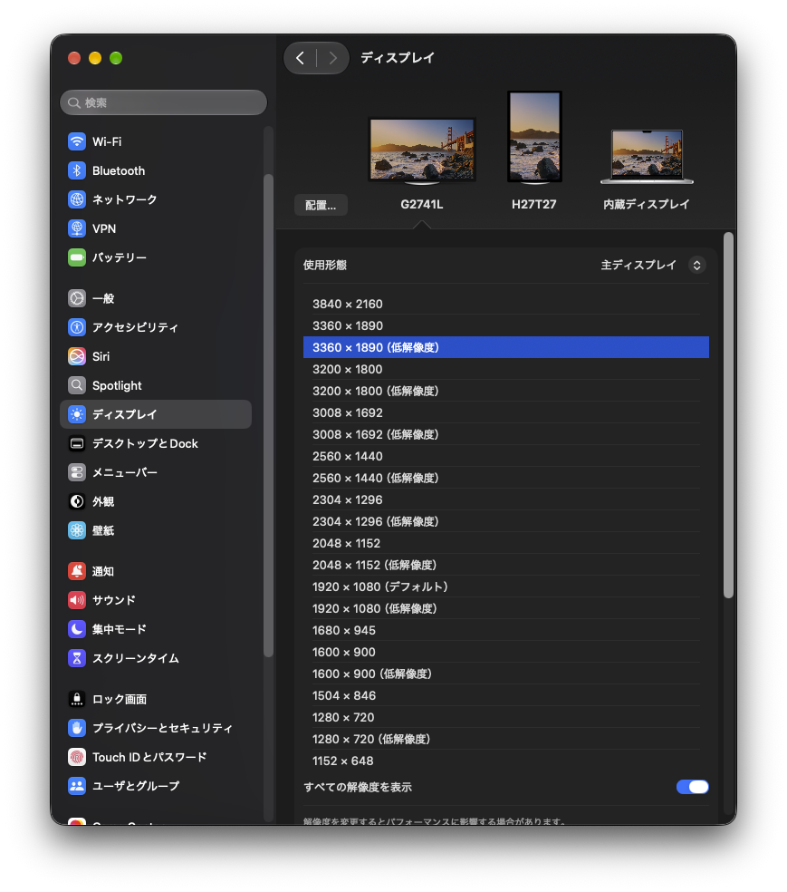

# 4Kディスプレイを買うとき、27インチを買うのは待って
[お金がなくて6月にいなくなろうと考えていた](https://note.com/tamaina/n/n34a86c9d0e68)のですが、某氏が10万円貸与する代わりにリモートのバイトを紹介すると言うので、せっかくなのでやっています。報道系のデータ入力といったところです。

さて、このバイトは多くのブラウザタブを開くことが必要なため4Kディスプレイを要求するのですが、27インチを購入したところ、様々な不都合がありました。

ちなみに今のところ経済状況は良くなっていませんが、なんとかやっていっています。

## 等倍だと文字が小さすぎる
等倍で表示すると文字が小さすぎて、目が疲れます。

## 1段階拡大するとメモリを圧迫する (Mac限定)
1段階拡大スケーリングをして3360x1890の解像度でHiDPIスケーリングすると、まあまあ読めるサイズになりますが、Macのメモリを圧迫します。  
等倍で **1.3GB** だったものが **1.9GB** まで増えます。

macOSの内部処理として、まずUIを3360x1890の2倍の長さ=6720x3780の解像度で描画し、そこから3360x1890に縮小して表示するらしいです。約3倍の画素数を描画することになるわけです。MacはVRAMを搭載しないので、これがCPUのメモリを圧迫してきます。やめてくれ。 

HiDPIを使わない3360x1890描画も選択できますが、やはり若干ぼやけます。正直好きではありません。

これに関しては、等倍かHiDPIかしか選べないmacOSが悪いともいえます。Windowsに明確に劣る部分です。  
逆に、Macは等倍でも描画が綺麗であることが利点なので、4Kディスプレイを等倍で使えれば良いわけです。

## 普及していて安いからといって27インチを脳死で買うのはやめた方が良い
というわけで、30インチ以上のディスプレイが欲しい！

## M1Proチップのディスプレイ帯域が狭いのも辛い
4K 160Hzが出るディスプレイを24k円で買ったのですが、M1Proチップのディスプレイ帯域が足りないせいで、表示が60Hzに制限されるし4:2:2転送になってしまうらしく赤が滲んでいて困っています。

PCを買い替えた方がいいのですが、そんなお金はなく……。

## Amazon
今回は紹介するような商品がないので、ただのAmazonへのリンクを貼っておきます。一緒にお買い物しましょう。  
https://link.amazon/B00LHSNNR
